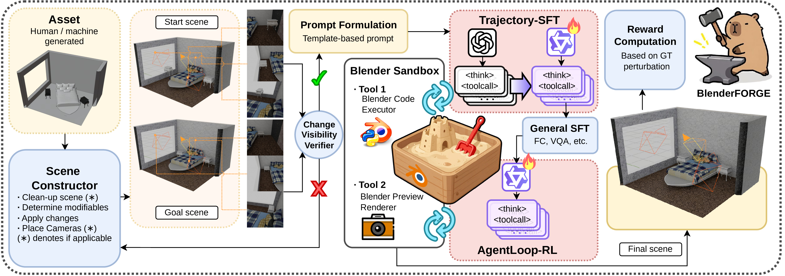

# BlenderFORGE

**Framework for Optimizing Reactive 3D-Graphics Editing Ability of MLLMs**

[Project Page](https://sensetime-fvg.github.io/BlenderFORGE/) ·
[Leaderboard](https://sensetime-fvg.github.io/BlenderFORGE/#results)

BlenderFORGE trains open-weight multimodal agents to edit explicit Blender scenes
through executable Python actions. It connects perturbation-based task generation,
an interactive Blender sandbox with rendered and structured feedback, and
trajectory supervised fine-tuning followed by multi-turn reinforcement learning.

The benchmark covers four editing families, with 9,000 training tasks and 800
test tasks. Qwen3-VL-8B and Qwen3.5-9B agents are compared with their respective
base models and zero-shot model references.



The project page includes the framework overview, video demonstrations and an
interactive leaderboard with task filters, metric sorting and CSV export.

## Release Checklist

- [ ] **Evaluation code:** multi-model evaluation, task prompts and metric aggregation.
- [ ] **Blender Sandbox:** executable scene editing, rendered feedback and scene-state export.
- [ ] **Training code:** supervised fine-tuning and multi-turn reinforcement learning.
- [ ] **Data generation pipeline:** task construction, scene perturbation and validation.
- [ ] **Model checkpoints:** BlenderFORGE-trained models on Hugging Face.
- [ ] **Datasets:** editing tasks, metadata and evaluation splits on Hugging Face.

## Citation

```bibtex
@misc{blenderforge,
  title  = {BlenderFORGE: Framework for Optimizing Reactive
            3D-Graphics Editing Ability of MLLMs},
  author = {TBD},
  year   = {TBD}
}
```

## License

[MIT License](LICENSE).
