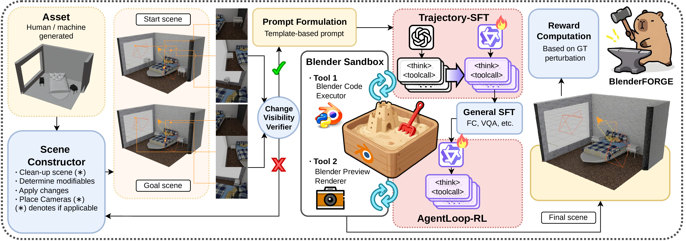

# BlenderFORGE: Framework for Optimizing Reactive 3D-Graphics Editing Ability of MLLMs

[Project Page](https://sensetime-fvg.github.io/BlenderFORGE/) ·
[Leaderboard](https://sensetime-fvg.github.io/BlenderFORGE/#results) ·
[arXiv](https://arxiv.org/abs/2611.10768v1) · Hugging Face

BlenderFORGE trains open-weight multimodal agents to edit explicit Blender scenes
through executable Python actions. It connects perturbation-based task generation,
an interactive Blender sandbox with rendered and structured feedback, and
trajectory supervised fine-tuning followed by multi-turn reinforcement learning.

The BlenderFORGE dataset spans four editing families and contains 9,000 training
tasks and 800 test tasks. The trained Qwen3-VL-8B and Qwen3.5-9B agents are
evaluated on the test split against their respective base models and zero-shot
model baselines.



## Release Checklist

- [x] **Project page:** framework overview, demonstration videos and interactive leaderboard.
- [ ] **Evaluation code:** multi-model evaluation, task prompts and metric aggregation.
- [ ] **Blender Sandbox:** executable scene editing, rendered feedback and scene-state export.
- [ ] **Training code:** supervised fine-tuning and multi-turn reinforcement learning.
- [x] **Data generation pipeline:** [task construction, scene perturbation and validation](src/BlenderFORGE_Data_Pipeline/README.md).
- [ ] **Model checkpoints:** BlenderFORGE-trained models on Hugging Face.
- [ ] **Datasets:** editing tasks, metadata and evaluation splits on Hugging Face.

## Data Generation

The [data pipeline](src/BlenderFORGE_Data_Pipeline/README.md) generates placement, lighting,
shape-key and material editing tasks, with a placement QA pipeline. It includes
shared sample validation and JSONL export, plus the derandomized Infinigen material
package and its [installation instructions](src/BlenderFORGE_Data_Pipeline/material/infinigen/README.md).

Run the pipeline commands from `src/BlenderFORGE_Data_Pipeline/`:

```bash
cd src/BlenderFORGE_Data_Pipeline
```

## Citation

```bibtex
@inproceedings{guo2026blenderforge,
  title     = {{BlenderFORGE}: Framework for Optimizing Reactive
               {3D}-Graphics Editing Ability of {MLLMs}},
  author    = {Guo, Zilin and Zhang, Tianrui and Rong, Yi and
               Liu, Yichen and Guo, Yuxin and Ni, Jingcheng and
               Lu, Lewei and Wu, Zehuan and Xu, Dan},
  booktitle = {The Fortieth Annual Conference on Neural Information Processing Systems},
  year      = {2026},
  url       = {https://openreview.net/forum?id=czK5BBdtMP}
}
```

## License

[MIT License](LICENSE).

Bundled Infinigen material sources retain their
[BSD 3-Clause license](src/BlenderFORGE_Data_Pipeline/material/infinigen/materials_static/LICENSE).
